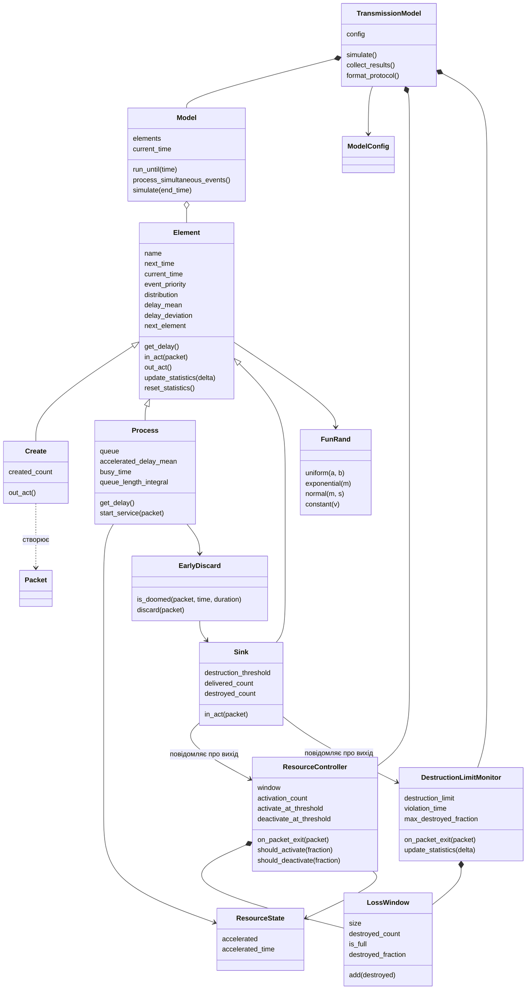

# Імітаційна модель передачі цифрового мовлення (курсова робота, варіант B8)

Модель передачі пакетів цифрового мовлення, побудована як мережа масового обслуговування. Алгоритм просування модельного часу реалізовано самостійно, без SimPy та інших бібліотек імітації. Структура класів побудована за лекцією 4: `Element` (з параметрами затримки та методом `get_delay()`) → `Create`, `Process`, `Sink`; універсальний `Model` над списком елементів; `FunRand`. Роль `SimModel` (збирання конкретної мережі) виконує `TransmissionModel`. Специфічні для B8 класи `ResourceState`, `ResourceController`, `DestructionLimitMonitor` і `EarlyDiscard` не є елементами мережі: вони не планують власних подій, а реагують на події елементів.

## Опис моделі

- **Надходження.** Пакети надходять із інтервалом, рівномірно розподіленим на [3; 9] мс (середнє 6 мс).
- **Канали.** Кожен пакет послідовно обслуговують два канали, K1 та K2, кожен з FIFO-чергою необмеженої ємності. Тривалість обслуговування становить 5 мс, а з підключеним додатковим ресурсом (R = 1) — 4 мс. Тривалість визначається в момент початку обслуговування.
- **Знищення.** Пакет знищується, якщо його час перебування в мережі T > 10 мс (допуск 1e-9). Мінімальний час передачі без ресурсу дорівнює 5 + 5 = 10 мс, тому без прискорення знищується кожен пакет, що хоч трохи чекав у черзі. Тлумачення «більш 10 мс» як строгої нерівності принципове: за «≥ 10 мс» без ресурсу знищувалися б усі пакети.
- **Керування ресурсом.** Контролер стежить за ковзним вікном з N = 100 останніх пакетів. Рішення ухвалюються лише після заповнення вікна:
  - ресурс підключається, коли частка знищених у вікні ≥ θ = 0.30;
  - ресурс вимикається, коли частка знищених < θ_off (за замовчуванням θ_off = θ).

  **Чому підключення за «≥», а не за «>».** Умова (посібник, с. 17): «Знищення більш 30% пакетів неприпустимо. **При досягненні такого рівня** система за рахунок ресурсів прискорює передачу до 4 мс на канал». Отже, ресурс підключається вже при досягненні межі 30%, а не після її перевищення: при 30 знищених зі 100 наступний знищений пакет зробив би рівень неприпустимим. Саму вимогу «більш 30% неприпустимо» перевіряє монітор строгою нерівністю. Вимкнення залишається строгим (< θ_off): якщо вимикати вже на рівні 30%, контролер вмикав би й вимикав ресурс на тому самому значенні й перемикався б майже втричі частіше. Інші варіанти меж порівняно в `threshold_bounds.csv` (див. «Основні результати»). Межі задаються параметрами `activate_at_threshold` і `deactivate_at_threshold`.

  **Чому рішення лише після заповнення вікна.** За неповним вікном частка має завеликий розкид: перший же знищений пакет дав би рівень 100% і хибне підключення. Тому перші N − 1 = 99 виходів контролер лише накопичує. У базовому сценарії це ≈ 0.6 с модельного часу, тобто ця ділянка повністю лежить у періоді розгону T_warm = 30 с і на статистику не впливає.
- **Контроль вимоги «не більше 30%».** Окремий монітор `DestructionLimitMonitor` (незалежно від режиму керування) веде власне ковзне вікно з 100 останніх пакетів і рахує частку часу та частку виходів, коли у вікні знищено **понад** 30% пакетів, а також найбільшу частку знищених у вікні. Так вимогу перевіряють не лише за середнім P_зн, а й за поточним рівнем знищення.
- **Час.** Усі значення часу вказано в мілісекундах.
- **Статистика.** Модель збирає частку та частоту знищених пакетів, частоту підключень ресурсу, частку часу з R = 1, середні довжини черг і завантаження (зважені за часом) та середній час очікування. Очікування рахується для кожного пакета, що залишив чергу, зокрема й для відкинутого раннім відкиданням, тому завжди виконується закон Літтла L = λ·W. Після періоду розгону T_warm статистика скидається.
- **Режими керування** (`control_mode`): `adaptive` (за порогом), `never` (ресурс ніколи не підключається), `always` (ресурс підключено завжди).
- **Раннє відкидання** (`early_discard`, пропозиція розділу 5, за замовчуванням вимкнене). На початку обслуговування канал відкидає пакет, якщо навіть за поточної швидкості обох каналів він уже не встигне за 10 мс: очікування + власне обслуговування + обслуговування в K2 > 10 мс. Відкинутий пакет вважається знищеним і потрапляє у ковзне вікно контролера.

### Чому час передачі детермінований

За методичкою (с. 12) затримку, задану лише середнім значенням, вважають експоненційною, якщо не сказано інакше. Тут прийнято детерміновані 5 мс і 4 мс, бо в умові сказано «час передачі пакета **складає** 5 мс», а не «в середньому». Крім того, пакети цифрового мовлення мають фіксовану довжину, і канал зі сталою швидкістю передає кожен пакет за однаковий час. Експоненційний варіант теж досліджено (`python -m experiments.sensitivity`). За нього вимога P_зн ≤ 30% недосяжна навіть з постійно підключеним ресурсом (див. «Основні результати»), тобто логіка керування з умови втратила б сенс.

### Генератори випадкових величин

`FunRand` перетворює рівномірне випадкове число U ∈ [0; 1) методом оберненої функції:

- рівномірний закон на [a; b]: x = a + (b − a)·U;
- експоненційний закон із середнім m: x = −m·ln(1 − U).

### Одночасні події

Коли кілька подій припадають на один момент часу, їх виконують у порядку K2 → K1 → надходження. При детермінованому обслуговуванні такі збіги часті: K1 і K2 завершують обслуговування одночасно щоразу, коли перед K1 є черга (близько 14% моментів подій у базовому сценарії). Порядок обрано з логіки системи:

1. Вихід пакета з K2 оновлює ковзне вікно, і контролер може перемкнути ресурс. Рішення має діяти на всі обслуговування, що починаються в цей момент, тому K2 обробляється першим.
2. Завершення в K1 передує надходженню ззовні. Канал звільняється раніше, ніж новий пакет стає в чергу, тож пакет не чекає фіктивно.

Наслідок порядку K2 → K1: черга перед K2 при детермінованому обслуговуванні ніколи не утворюється. Пакет n+1 починає обслуговування в K1 не раніше, ніж пакет n починає в K2. Між цими моментами стан ресурсу може змінитися лише на виході з K2, а K2 у цей час зайнятий пакетом n. Тому обидва обслуговування мають однакову тривалість, і пакет n+1 приходить у вже вільний K2. За зворотного порядку K1 → K2 частота підключень ресурсу змінюється приблизно на 5%, тобто на величину, значно більшу за довірчий інтервал. Обидві властивості перевіряються у верифікації (сценарії `priority_*`).

### Структура проєкту

```
simulation/        ядро моделі
  config.py          параметри моделі (ModelConfig)
  fun_rand.py        генератори випадкових величин (FunRand)
  packet.py          пакет і записи про проходження вузлів
  element.py         базовий клас Element: параметри затримки, get_delay()
  create.py          генератор пакетів (Create)
  process.py         канал обслуговування з чергою (Process)
  sink.py            вихід мережі, перевірка порогу знищення (Sink)
  resource_state.py  стан додаткового ресурсу
  loss_window.py     ковзне вікно результатів останніх N пакетів (LossWindow)
  controller.py      контролер ресурсу з ковзним вікном
  destruction_limit_monitor.py  контроль вимоги: рівень знищення у вікні 100 пакетів > 30%
  early_discard.py   раннє відкидання пакетів, що не встигнуть (пропозиція)
  model.py           універсальне ядро: просування часу до найближчої події, пріоритет одночасних подій (Model)
  transmission_model.py  мережа B8: побудова, T_warm, трасування, протокол подій, результати (TransmissionModel)
  analytics.py       аналітичні формули (M/M/1, мережа Джексона)
experiments/       сценарії експериментів
  common.py          паралельні прогони, довірчі інтервали, запис CSV і тексту
  plotting.py        спільний стиль графіків
results/           усі результати (CSV, PNG, TXT, JSON)
```

### Діаграма класів



## Встановлення

Потрібен Python 3.13 або новіший. Повний цикл експериментів виконано на Python 3.14.6 з numpy 2.5.4, scipy 1.18.1 та matplotlib 3.11.2 (версії зафіксовано в `requirements.txt`). На Python 3.13.1 перевірено ядро моделі та імпорт усіх скриптів.

```bash
python -m venv .venv
.venv\Scripts\activate          # Windows
source .venv/bin/activate       # Linux / macOS
pip install -r requirements.txt
```

## Запуск експериментів

Усі скрипти запускаються з кореня проєкту командою `python -m experiments.<назва>`. На Windows для коректного виводу кирилиці в консоль варто встановити `PYTHONIOENCODING=utf-8`.

Скрипти потрібно виконувати в наведеному порядку. `transient` і `replications` записують у `results/run_params.json` параметри T_warm, T_mod і кількість прогонів, а всі наступні експерименти їх читають.

| № | Команда | Що робить | Результати |
|---|---------|-----------|------------|
| 1 | `python -m experiments.verification` | Верифікація: 32 сценарії з передбачуваним результатом (зокрема пріоритет подій, точний момент підключення ресурсу, допуск порогу знищення, гістерезис, закон Літтла, баланс потоку, раннє відкидання), протокол подій | `verification.csv`, `event_protocol.txt`, `event_protocol_switch.txt` |
| 2 | `python -m experiments.validation` | Перевірка за аналітикою (експоненційні розподіли, M/M/1 і мережа Джексона, P(T > 10 мс) за теоремою Райха); формула хвоста P(T > 10 мс) проти чисельного інтегрування, зокрема для різних μ1 ≠ μ2; перевірка базової моделі B8 з контролером незалежним рекурсивним алгоритмом | `validation.csv`, `validation_tail_formula.csv`, `validation_recursion.csv` |
| 3 | `python -m experiments.transient` | Перехідний період: T_warm методом Велча за всіма трьома відгуками, T_mod за критерієм (3.1); контрольна перевірка за найбільшого навантаження | `transient.csv`, `transient_*.png`, `run_params.json` |
| 4 | `python -m experiments.replications` | Необхідна кількість прогонів за нерівністю Чебишова (3.4), β = 0.95, ε = 1% | `replications.csv`, `replications_required.png`, `run_params.json` |
| 5 | `python -m experiments.run_base` | Базовий сценарій B8, порівняння режимів `adaptive`/`never`/`always`, однофакторний дисперсійний аналіз, гістограма часу перебування | `base_summary.csv`, `base_modes.csv/png`, `base_anova.csv`, `base_sojourn_histogram.png` |
| 6 | `python -m experiments.factors` | Однофакторні експерименти: інтервал надходження (з регресією), розмір вікна N, поріг θ | `factor_*.csv`, `factor_*.png` |
| 7 | `python -m experiments.proposals` | Пропозиції: гістерезис, зміна θ і N, раннє відкидання, парний t-тест, множина Парето, двофакторний експеримент θ_off × N із дисперсійним аналізом | `proposal_*.csv`, `proposal_*.png` |
| 8 | `python -m experiments.threshold_bounds` | Чутливість до меж порогу керування: «≥» чи «>» для підключення, «<» чи «≤» для вимкнення, спільні випадкові числа | `threshold_bounds.csv` |
| 9 | `python -m experiments.sensitivity` | Чутливість до закону часу обслуговування: детермінований чи експоненційний, у трьох режимах керування | `sensitivity_service_law.csv/png` |
| 10 | `python -m experiments.distribution` | Ідентифікація закону розподілу за критерієм χ²: інтервал між підключеннями ресурсу (4 гіпотетичні закони, 20 прогонів), нормальність оцінок P_зн і частоти підключень за прогонами | `distribution_*.csv`, `distribution_*.png` |

Окремий фактор можна запустити так: `python -m experiments.factors --factor interval` (можливі значення: `interval`, `window`, `threshold`, `all`).

Прогони виконуються паралельно на всіх ядрах процесора. Повний цикл усіх скриптів займає близько півтори години (найдовші — `factors` і `proposals`). Для фіксованих seed і зафіксованих версій бібліотек повторний запуск дає ті самі файли.

## Методика експериментів

- **Протокол подій** містить повний стан моделі після кожної події: моменти наступних подій `t_next` для генератора та обох каналів (∞ — подію не заплановано), довжини черг, стан каналів, тривалість обслуговування, час перебування T пакета, що виходить, результат (доставлено / знищено) і стан ковзного вікна.
- **Перехідний період.** Для кожного з трьох відгуків (P_зн, частота підключень, частка часу з R = 1) ансамблеве середнє за 8 пробними прогонами згладжується методом Велча. Півширина вікна w обирається найменшою з ряду 5, 10, 20, 50, 100, 200, за якої на другій половині горизонту згладжений ряд не відхиляється від сталого рівня більше ніж на ε = 5%. Кінець перехідного періоду — момент, після якого відхилення завжди ≤ ε. T_warm дорівнює подвоєному максимуму за трьома відгуками.
- **Перевірка за найбільшого навантаження.** Ту саму процедуру повторено для інтервалу unif(2; 8) мс (найменший середній інтервал у факторному експерименті). Обраних T_warm і T_mod достатньо для P_зн і частки часу з R = 1. Частота підключень там має менший рівень (≈ 4.2 1/с) і більший розкид, тому одиночний прогін досягає ε = 5% лише за ≈ 1.9·10⁶ мс. Подовжувати через це всі прогони втричі недоцільно: точність середнього за 62 прогонами видно безпосередньо з напівширини довірчого інтервалу в `factor_interval.csv`.
- **Дві різні точності ε.** Критерій (3.1) з ε = 5% визначає, скільки має тривати один прогін, щоб його оцінка стабілізувалася. Формула (3.4) з ε = 1% визначає кількість прогонів, потрібну для середнього за прогонами. Ці величини узгоджені: середнє за p незалежними прогонами має розкид приблизно в √p разів менший, і для p = 62 точність 5% одного прогону переходить у ≈ 0.6% для середнього, що не гірше за 1%.
- **Порівняння режимів керування** використовує незалежні потоки випадкових чисел для кожного режиму, як того вимагає дисперсійний аналіз. Порівняння пропозицій навпаки використовує спільні випадкові числа і парний t-тест.
- **Дисперсійний аналіз** використовує стандартні ступені вільності: q − 1 для фактора і N − q для залишку (однофакторний), (a − 1), (b − 1), (a − 1)(b − 1) і ab(n − 1) для двофакторного. Однофакторний результат збігається зі `scipy.stats.f_oneway`. Знаменник «q·p − 1» у формулі (3.10) методички не відповідає стандартній F-статистиці, тому його не використано. Через велику кількість прогонів F-статистики дуже великі, і сама істотність мало що говорить. Тому для кожного джерела наведено частку впливу η² = SS_фактора / SS_загальна (для двофакторного аналізу також частковий η²).
- **Регресія за інтервалом надходження** будується за нормалізованим фактором x = (c − c0)/Δ ∈ [−1; 1] (формула 3.6) лише на ділянці, де відгук ненульовий. Степінь полінома (1–4) обирається серед статистично значущих (p < 0.05) і невід'ємних на всій ділянці моделей за найменшою похибкою перехресної перевірки (leave-one-out RMSE). Така похибка оцінює якість передбачення в точках, не використаних для побудови, тому захищає від перенавчання полінома високого степеня на малій кількості точок. Для кожної моделі вказано, чи досягнуто індексу кореляції R ≥ 0.7. Праворуч від ділянки регресії відгук дорівнює нулю (плато, `factor_interval_plateau.csv`). Для P_зн плато починається з 8 мс: тоді мінімальний інтервал між пакетами (c − 3 мс) не менший за 5 мс, черги не утворюються, час перебування дорівнює рівно 10 мс.
- **Пропозиції** оцінюються за двома витратами ресурсу: частотою підключень і часткою часу з R = 1. Зменшення однієї зазвичай збільшує іншу, тому замість одного «найкращого» варіанта наводиться множина Парето серед варіантів із P_зн ≤ 30% (за верхньою межею 95% ДІ). Двофакторний експеримент θ_off × N (3 × 3 рівні) із двофакторним дисперсійним аналізом оцінює вплив кожного фактора та їх взаємодію.
- **Ідентифікація закону розподілу** (посібник, с. 12 і 82) виконується за критерієм χ² з рівноймовірними інтервалами, кількість яких визначає формула Стерджеса k = 1 + 3.322·lg n (за умови, що очікувана частота в інтервалі не менша за 5), а ступені вільності дорівнюють k − 1 − r. Параметри оцінюються методом максимальної правдоподібності. Перевірку інтервалу між підключеннями повторено у 20 незалежних прогонах, тож висновок не залежить від одного прогону. Кількість знищених пакетів за секунду не перевіряється: сусідні значення сильно корельовані (≈ −0.54), а критерій χ² вимагає незалежних спостережень.
- **Межі перевірки за аналітикою.** Аналітичний розв'язок існує лише для експоненційних законів без керування (режими `never` і `always`, мережа Джексона). Тому базову модель B8 з рівномірним надходженням, детермінованим обслуговуванням і контролером додатково перевірено незалежним алгоритмом іншого типу, без календаря подій. Рекурсія тандему D1 = max(A, D1_попер) + S1, D2 = max(D1, D2_попер) + S2 використовує той самий потік випадкових чисел, а стан ресурсу в момент початку кожного обслуговування визначає за історією перемикань контролера. Збіг має бути точним, а не статистичним (`validation_recursion.csv`).

## Основні результати

T_mod = 600 000 мс, T_warm = 30 000 мс, 62 прогони. Після ± вказано напівширину 95% довірчого інтервалу.

- **Перевірка моделі.**
  - Верифікація: пройдено 32 сценарії з 32. Серед них є точні ручні розрахунки моменту підключення: за інтервалу 4 мс і N = 100 ресурс підключається рівно в 509 мс (вихід 100-го пакета, у вікні 99 знищених), за N = 1 — рівно в 19 мс. Другий сценарій відрізняє правило T > 10 від T ≥ 10: за помилкового «≥» підключення настало б уже в 14 мс.
  - Перевірка за аналітикою мережі Джексона: 24 значення з 24 потрапили в довірчий інтервал. Сценарії мають однакові μ в обох вузлах, тому формулу хвоста для μ1 ≠ μ2 окремо звірено з чисельним інтегруванням згортки: 5 випадків із 5 збіглися з точністю 10⁻¹¹ (`validation_tail_formula.csv`).
  - Незалежна рекурсія тандему: 48 показників з 48 збіглися з подійною моделлю точно (8 сценаріїв, зокрема з керуванням, гістерезисом і всіма варіантами меж порогу «≥»/«>», «<»/«≤»).
- **Перехідний період.** T_warm і T_mod обрано за базовим сценарієм. У сценарії найбільшого навантаження (unif(2; 8) мс) їх достатньо для P_зн і частки часу з R = 1. Для частоти підключень одиночний прогін там не досягає точності ε за критерієм (3.1) (див. `transient.csv`), проте середнє за 62 прогонами (4.219 ± 0.026 1/с) відрізняється від сталого рівня пробних прогонів тривалістю 2·10⁶ мс лише на 0.01%, тобто систематична похибка майже в 50 разів менша за напівширину ДІ.
- **Базовий сценарій B8** (θ = 30%, N = 100):
  - P_зн = 28.15 ± 0.01%;
  - частота підключень ресурсу 7.28 ± 0.03 1/с;
  - ресурс підключено 31.1 ± 0.1% часу;
  - середній час перебування 9.83 мс;
  - поточний рівень знищення у вікні 100 пакетів перевищує 30% протягом 11.5 ± 0.1% часу, найбільша частка знищених у вікні в середньому 38.7%.

  Вимогу P_зн ≤ 30% за середнім рівнем виконано, але через реактивність керування поточний рівень регулярно її перевищує. Без керування P_зн = 45.1%, з постійно підключеним ресурсом — 0.13%. Режим керування пояснює майже всю дисперсію відгуків (η² ≈ 1.00).
- **Межі порогу керування** (`threshold_bounds.csv`, спільні випадкові числа, парний t-тест):

  | Підключення / вимкнення | P_зн, % | Підключень, 1/с | Частка часу R = 1, % | Частка часу з рівнем > 30%, % |
  |---|---|---|---|---|
  | ≥ 30% / < 30% (основний) | 28.15 ± 0.01 | 7.28 ± 0.03 | 31.1 ± 0.1 | 11.5 ± 0.1 |
  | > 30% / < 30% | 28.55 ± 0.01 | 4.79 ± 0.02 | 32.0 ± 0.1 | 24.0 ± 0.1 |
  | > 30% / ≤ 30% | 29.01 ± 0.01 | 7.15 ± 0.03 | 29.3 ± 0.1 | 29.3 ± 0.1 |
  | ≥ 30% / ≤ 30% | 28.51 ± 0.01 | 20.06 ± 0.07 | 27.6 ± 0.1 | 17.9 ± 0.1 |

  Відмінність P_зн від основного варіанта істотна для кожного варіанта (парний t-тест, p < 10⁻⁷⁹), але сама P_зн змінюється не більше ніж на 0.9 п. п., і вимога P_зн ≤ 30% виконується за будь-якого варіанта. Найсильніше межа впливає на частку часу, коли поточний рівень перевищує 30%: підключення «при досягненні» рівня (≥) зменшує її вдвічі порівняно зі строгим «>». Нестроге вимкнення (≤) саме по собі частоту підключень майже не змінює (за строгого підключення 7.15 проти 7.28 1/с). Але разом із підключенням за «≥» межі вмикання й вимикання збігаються на значенні 30%, ресурс перемикається туди й назад, і частота підключень зростає майже втричі (20.06 1/с).
- **Інтервал надходження.** P_зн ≤ 30% досягається за середнього інтервалу від 5.5 мс. Починаючи з 8 мс, знищень немає. Частота підключень найбільша (≈ 7.6 1/с) за інтервалу 5.75 мс і спадає практично до нуля з 7 мс. За перехресною перевіркою для всіх відгуків обрано поліном 4-го степеня.
- **Пропозиції.** У дужках вказано зміни щодо базового сценарію.
  - Раннє відкидання без ресурсу: пакет, який за поточного стану ресурсу вже не встигне за 10 мс, відкидається до початку обслуговування. Це дає P_зн = 24.97% без жодного підключення ресурсу. Тому серед усіх варіантів із P_зн ≤ 30% множина Парето складається лише з нього.
  - Якщо ресурс потрібен, множина Парето серед варіантів, що його використовують:

    | Варіант | Частота підключень | Частка часу з R = 1 | P_зн |
    |---------|--------------------|---------------------|------|
    | раннє відкидання + керування 30/30 | 1.33 1/с (−82%) | 1.9% (−94%) | 24.6% |
    | гістерезис 30/20 + N = 300 | 0.45 1/с (−94%) | 45.8% (+47%) | 24.3% |

  - Гістерезис без раннього відкидання зменшує частоту підключень на 70–82%, але збільшує час роботи ресурсу на 30–76%.
  - За поточним рівнем знищення: гістерезис із порогом підключення 30% майже не зменшує частку часу з рівнем понад 30% (10–12%), вікно контролера N = 300 її збільшує (40–44%). Поріг підключення 25% знижує її до 0.1–0.3%, а раннє відкидання з керуванням 30/30 — до 0.001%. Тому за суворого тлумачення вимоги рекомендовано раннє відкидання з керуванням 30/30, а без нього — поріг підключення 25%.
- **Ідентифікація закону розподілу (критерій χ², α = 0.05).** Інтервал між послідовними підключеннями ресурсу (середнє 136.9 мс, що відповідає ≈ 7.3 підключенням за секунду) описується логнормальним законом зі зсувом: гіпотезу прийнято у 18 із 20 прогонів. Експоненційний, гамма- і вейбуллівський закони відхилено в усіх 20 прогонах. Оцінки P_зн, частоти підключень і частки часу з R = 1 за окремими прогонами мають нормальний розподіл (p = 0.63–0.87), що обґрунтовує довірчі інтервали за Стьюдентом.
- **Двофакторний експеримент θ_off × N.** За дисперсійним аналізом обидва фактори та їхня взаємодія істотно впливають на всі три відгуки (p < 0.001). Проте майже всю мінливість пояснює θ_off: η² = 0.96 для P_зн, 0.94 для частоти підключень і 0.99 для частки часу з R = 1. Внесок N і взаємодії разом не перевищує 5.5%.
- **Чутливість до закону обслуговування.** Якщо замінити детерміноване обслуговування експоненційним із тими самими середніми, P_зн зростає до 68% з керуванням і навіть із постійно підключеним ресурсом. Вимога P_зн ≤ 30% стає недосяжною за будь-якого режиму. Отже, висновки роботи суттєво спираються на детермінованість часу передачі.

## Результати

Усі результати зберігаються лише в каталозі `results/`:

- **`*.csv`** — таблиці з середніми та напівширинами 95% довірчих інтервалів, заголовки українською з одиницями вимірювання. Кодування UTF-8 з BOM, тому файли коректно відкриваються в Excel.
- **`*.png`** — графіки. Осі підписано з одиницями, а в підписі під графіком вказано час моделювання, T_warm і кількість прогонів.
- **`run_params.json`** — обрані T_warm, T_mod, кількість прогонів і проміжні дані для їх обґрунтування.
- **`event_protocol*.txt`** — протоколи подій для верифікації.
